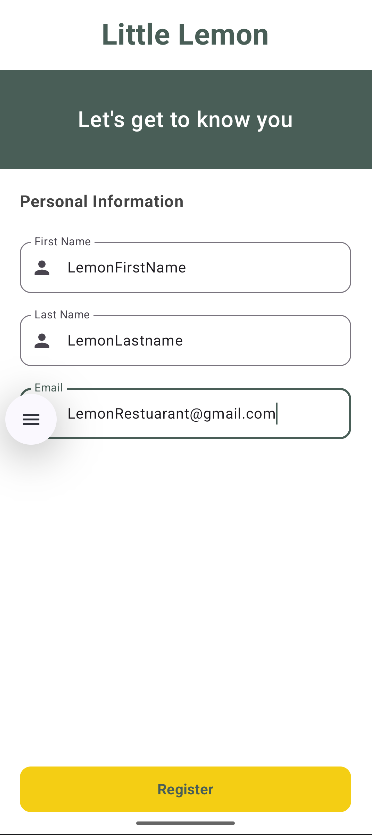
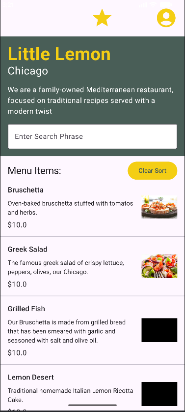
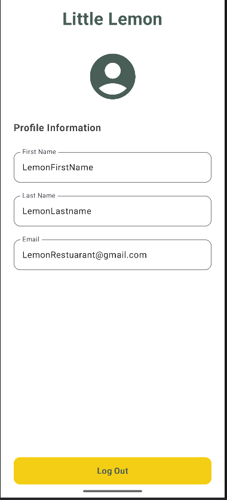

# Little Lemon Android App

A native Android application built with Kotlin and Jetpack Compose for the Little Lemon restaurant. This app allows users to register an account, browse the restaurant's menu, search for specific dishes, and manage their profile.

## Features

* **User Onboarding:** Registration screen that saves user data locally.
* **Menu Browsing:** Displays a list of menu items fetched from a local database.
* **Search & Filter:** Users can search for dishes by name and sort the menu alphabetically.
* **Profile Management:** Displays saved user information with the ability to log out and clear data.

## Screenshots

  
  
  

## Tech Stack

* **Language:** Kotlin
* **UI Toolkit:** Jetpack Compose
* **Navigation:** Jetpack Navigation Compose
* **Local Storage:** SharedPreferences (User Data) & Room Database (Menu Items)

## How to Run

1. Clone this repository.
2. Open the project in Android Studio.
3. Build and run the project on an emulator or a physical Android device.